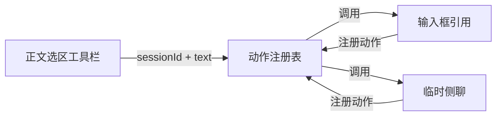

# Codex 工作台架构

模块按状态和操作的归属划分。设置页按任务分组。
`src/catalog.json` 是能力 ID、源码路径和分组的唯一清单。
包名、加载器 ID 和旧设置键用于兼容已有安装。

## 状态归属

| 模块 | 拥有的状态 | 与宿主连接的方式 |
|---|---|---|
| `navigation` | 列表呈现偏好、导航历史 | 工作区状态、布局操作和侧栏 slot |
| `composer` | 输入历史、选区引用、附件恢复缓存 | InputShell 状态与公开附件接口 |
| `conversation` | 当前选区、工具栏位置、文件与附件菜单 | 对话正文 DOM 和动作注册表 |
| `panels` | 临时子会话、标签元数据、侧聊草稿 | 右侧面板注册、会话绑定与归档接口 |
| `shared` | 动作注册、能力健康状态和呈现适配 | 各能力的生命周期范围 |

会话正文、队列、上传任务和附件对象仍由 DSH 拥有。
排队模块订阅 `shell.state`，通过 `resolveDraftAttachments` 读取活跃附件。
上传回执用于匹配文件缓存。
共享 `ConversationController` 的 `createDrafts` 和 `updateQueue` 方法不再被改写。

## 跨区域动作

正文模块只读取正文中的选择。输入框和面板模块负责各自的操作。
注册记录包含 `id`、顺序、标签、`supports(context)` 和 `run(context)`。
调用上下文仅包含会话 ID 和文本，并在调用前冻结。
动作执行前会重新检查可用性。

注册由提供方的 `ctx.effect` 持有。
提供方停用、释放或隔离时，入口随注册移除。
工具栏可以继续显示其他提供方的动作。
内容模块不导入侧聊组件，也不查找侧聊的 DOM。

## 生命周期与失败

- 能力构建、应用、slot 回调和 React 渲染分别受隔离范围保护。
- 嵌套注入的 effect 跟随实际服务上下文释放。
- DOM 监听器、观察器、portal 和注册项有对应的清理操作。
- 侧聊创建完成后会检查取消状态。已关闭的面板不会接收迟到结果。
- 释放中的会话绑定不会触发解除归档或再次打开。
- 提交失败只恢复本次操作仍拥有的草稿，保留期间新增的输入。

归档或持久化失败会保留恢复所需的记录，并报告失败。
队列锁定写入失败会撤销本次内存变更。

## UI 适配

交互控件复用 DSH 的 `Menu`、`Modal`、`Switch`、`Tooltip` 和图标组件。
颜色使用语义 token。宿主 DOM 适配集中在导航、输入区呈现和队列装饰中。
窗口材质（标题区与左栏）由 Windows 强调色驱动：
宿主侧用 `RegNotifyChangeKeyValue` 监听系统颜色注册表项（单个只读 PowerShell 辅助进程，不轮询），
通过同源事件流把色板推给浏览器；浅色表面用基础强调色，深色表面用浅一档的强调色。
辅助进程不可用时回退到短周期 GET 轮询；读不到色板时回退主题表面色。

顶栏三个按钮为 28px，间隔 6px。
左侧导航栏宽 52px，按钮为 36px，图标盒为 20px。
导航图形直接来自 DSH；激活态调整绘制属性，不复制 SVG 路径。

这些适配以 DSH `0.2.1-rc.2` 为基线。
升级宿主后，先运行独立 UI fixture，再决定是否更新选择器。
